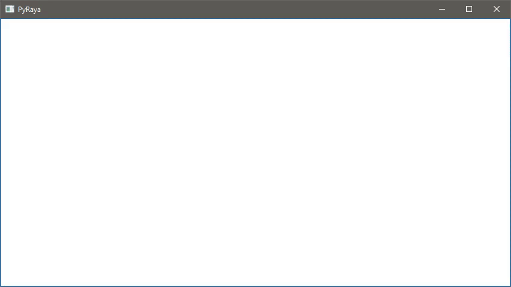

# PyRaya (پیرایہ)

قلم کی روانی، سوچ کی آسانی؛ اردو تحریر کا نیا پیرایہ۔

A PySide6 text editor for Urdu. Drop the widget into your app and it handles
right-to-left paragraphs, a Nastaliq font stack, and typing Urdu from a roman
keyboard.

⚠️ **Alpha** · `0.1.0a14` · Python 3.13+ · PySide6

---

## Why PyRaya exists

Urdu writers type on roman keyboards and expect Urdu script on the page. Qt
shapes Nastaliq well, then hands you the rest: paragraph direction, a font
stack that carries Nastaliq beside English, and a way to turn `salam` into
سلام. PyRaya does that work. Type a roman word, choose the Urdu spelling from
a list, and the page stays in Urdu the whole time.



*Interacitve realtime conversion of each typed Urdu word from Roman-script input to Arabic-script.*

## Install

No package is published yet. In a clone of this repository, `uv sync` builds a
virtual environment with the pinned dependencies, and `uv run pyraya` opens
the demo window.

## Sixty seconds

```python
import sys

from PySide6.QtWidgets import QApplication

from pyraya import PyRaya

app = QApplication(sys.argv)
editor = PyRaya()
editor.show()

sys.exit(app.exec())
```

Run it and a right-aligned editor opens, cursor at the top right. Type
`salam` and a small line with a suggestion list appears; press space and the
selected Urdu word lands in the document, in Urdu script.

## Features at a glance

- Right-to-left paragraphs, right-aligned from the first keystroke.
- Nastaliq and Latin on one line, from one font stack.
- Spaces and tabs drawn as visible marks.
- Spans tagged Native or Roman Urdu; Roman-Urdu text gets a faint
  tint, Native text carries no tint. See [Regions](#regions).
- Typed Latin marks and digits land in their Urdu forms inside a
  Roman-Urdu span; digits commit a roman-input word like punctuation.
  See [Character substitution](#character-substitution).
- Roman input: type `salam`, pick سلام, keep writing. See
  [Roman input](#roman-input).
- A wavy underline under words the dictionary does not know. See
  [Spell check](#spell-check).
- Unknown words can be learned into the shared dictionary, from the
  right-click menu or the `+ [..]` suggestion row. See
  [Learn a word](#learn-a-word).
- Light and dark themes: the document and the suggestion list follow your
  application's palette, recolouring live on a palette change. See
  [Theming](#theming).
- Word offsets for analysis: `wordRuns(text)` and `editor.wordRuns()`.
  See [Word runs](#word-runs).

## Regions

A region kind marks a character span with intent, and there are two kinds:
`RegionType.Native` for English and other Latin text, `RegionType.RomanUrdu`
for Urdu written in roman letters. Kinds are stored as a tag on the document's
characters — a stored tag wins, and untagged text *acts as* Roman Urdu (it
gets the Roman-Urdu tint and takes roman input). Native text carries no tint;
nothing else changes for it.

Tag a span three ways. Select text and use the right-click menu ("Region:
Native", "Region: Roman Urdu"), or with a selection press `Ctrl+1` for Native
or `Ctrl+2` for Roman Urdu, or call the API:

```python
from pyraya import RegionType

editor.setRegionType(RegionType.Native, 0, 12)  # tag characters 0 through 11
editor.regions()  # every tagged span as TextRegion(start, end, kind)
editor.clearRegions()  # every character resolves to the seed kind again
```

The tags live in the document itself, so they survive edits and undo. Each
method that changes regions emits `regionsChanged` once when it finishes.
`seedRegionKind()` answers the kind untagged text resolves to; the seed is
read-only. `setRegionColor(kind, color)` recolors one kind's tint, inside
this widget only — it touches no document state and repaints the tint
immediately.

## Character substitution

A fixed per-region table rewrites typed Latin characters to their Urdu
equivalents the moment they enter the document, inside a Roman Urdu span:
the full stop, comma, question mark, and semicolon become their
Arabic-script forms, and the digits 0–9 become the Eastern Arabic-Indic
digits. The colon is deliberately untouched — Urdu has no dedicated colon
codepoint and conventionally keeps the Latin one. Native spans pass every
character through, and the table is fixed (no host API): it is part of the
region model, not a per-widget setting.

The substitution is region-scoped, not feature-scoped: it holds whether or
not the roman-input overlay is on, and whether or not the overlay is
active. A typed mark or digit with no overlay active lands directly in the
document in its Urdu form, tagged with the region kind. With the overlay
active, a digit is a committing key like punctuation: it terminates the
word and commits, landing in its Urdu form as the separator. The four
mapped marks and the ten digits are the whole table; Latin letters are not
in it, so they still seed the overlay as before.

```python
from pyraya import RegionType, substituteChar

substituteChar(".", RegionType.RomanUrdu)  # "۔"
substituteChar("5", RegionType.RomanUrdu)  # "۵"
substituteChar("5", RegionType.Native)  # None — passes through
```

## Roman input

The overlay is on by default. Type a roman letter inside a Roman Urdu region
and a small line appears over the nearest Urdu word: your roman letters are
edited in that line while the document keeps its Urdu script. A suggestion
list sits under the line, or above it when the bottom is crowded. Green rows
match the word exactly, orange rows are one edit away, red rows two, and five
rows fit at a time with the list scrolling so the picked row stays visible.
The lookup is capped to the dictionary's longest word, so a long typed word
stays fast; the cap affects only the lookup, so the full word still commits.

Space or any punctuation key commits the selected word, and a typed
Urdu mark such as ۔ or ، goes with it. A digit commits too, landing in
its Eastern Arabic-Indic form as the separator (see
[Character substitution](#character-substitution)). Enter does not start
a new line; `Ctrl+Enter` does. `Ctrl+Up` and `Ctrl+Down` commit the
selected word without any separator and move the cursor one line up or
down.
Esc closes the overlay, and `Ctrl+Esc` closes it and turns assist mode
off, so typing and clicking stop opening it until `Ctrl+Space` brings it
back, over the word under the cursor or empty at the cursor. Two quick
Esc presses turn assist mode off as well, whether or not the overlay is
shown. Turning the feature off restores
plain typing:

```python
editor.setRomanInputEnabled(False)  # roman letters type into the document
editor.setAssistEnabled(False)  # the overlay stops opening on its own
```

## Spell check

The underline is on by default. Any Arabic-script word inside a Roman Urdu
region that the romanalfaz dictionary does not know gets a wavy brick-red
underline, so unknown words are visible without interrupting the flow. It is
display only: nothing corrects, nothing suggests, nothing enters the undo
stack, and Native-region text is never underlined. A *word* is a maximal run
of Arabic-script letters and combining marks: digits (`دوست۵` ends at
`دوست`), punctuation, and symbols are boundaries, and the invisible joiners
a copied word may carry (ZWNJ, ZWJ, LRM, RLM, ALM) neither split a word nor
form one. The ranges cover the Arabic block, its supplement, Extended-A, and
the presentation forms, so a word pasted from a PDF is still one word. The
switch is independent of roman input, so you can run the underline alone:

```python
editor.setSpellCheckEnabled(False)  # hide the underlines
```

## Word runs

The words in a text can be enumerated without touching the document:

```python
from pyraya import wordRuns

text = "کام دوست، ٹھیک"
for start, end in wordRuns(text):
    print(start, end, text[start:end])

for start, end in editor.wordRuns():  # absolute document offsets
    ...
```

Each run is a pair of offsets, not a substring — the caller slices. A run is
a maximal stretch of Arabic-script letters and combining marks: digits,
punctuation, and symbols end it, and the invisible joiners a copied word may
carry (ZWNJ, ZWJ, LRM, RLM, ALM) neither split a word nor form one.
`wordRuns(text)` takes a plain string, so a long text is one linear pass with
no document or `QApplication`; `editor.wordRuns()` adds each block's position
to give document offsets. Both only read: no edit, no undo step.

## Learn a word

Words the dictionary does not know can be added to it. Right-click an
unknown word in a Roman Urdu region and choose "Add to dictionary", or
commit the `+ [..]` row in the suggestion list. Either way the dialog's
field opens holding the word under the cursor — the word you clicked, or
the one you are romanizing — so OK is live at once. A live roman preview
sits under it, and OK is enabled only while the field holds a mappable
word. Accepting adds the word to the dictionary
— its underline clears, and it becomes suggestable from roman input;
cancelling writes nothing at all and adds nothing, so the word under the
cursor stays exactly as it was. The `+ [..]` row produces Arabic only:
cancelling it never inserts the typed roman, in any position.

The dictionary is shared by every widget in the process, so a word
learned in one editor is known to all of them. Saving it to disk is the
host application's job: it polls `localDictionary().isModified()` and
calls `Vocabulary.save` on the shared Vocabulary — PyRaya never writes
the file. A host can replace the dialog with its own through
`setAddWordHandler`, and each successful learn emits `wordAdded`:

```python
if editor.localDictionary().isModified():
    editor.localDictionary().save("dictionary.sym")
```

Restoring a saved dictionary at startup is likewise the host's job, and
it must be handed over in one piece. An attached `Vocabulary` recompiles
the whole lookup index on every `add`, so loading a stored dictionary one
word at a time is quadratic — seconds of frozen UI for a few dozen words.
Load it standalone first, then install it:

```python
from romanalfaz.engine import Vocabulary

loaded = Vocabulary.load("dictionary.sym")
editor.setLocalDictionary(loaded)  # one pass; every widget sees it
```

`setLocalDictionary` replaces rather than merges. Pass a Vocabulary that
holds every word the session should know; the shared engine is rebuilt
lazily, and the editor you called it on re-highlights immediately so its
spell-check underlines follow the new dictionary. Other editors pick up
the new underlines on their next re-highlight.

## Watching state changes

Three signals report this editor's own state to its host, so a UI can
follow without polling: `assistModeChanged(bool)` whenever assist mode
actually flips — the setter, `Ctrl+Space`, `Ctrl+Esc`, the double `Esc`,
and re-enabling roman input, which resets the mode to on —
`spellCheckChanged(bool)` when the underline switch flips, and
`dictionaryChanged(vocabulary)` when `setLocalDictionary` installs a
dictionary or a learned word changes the shared one, carrying the
Vocabulary now in effect. All three fire on an actual change only, so
echoing a value back into the setter never loops.

The dictionary is process-wide but each signal is local to the editor
that emitted it: a host running several editors forwards
`dictionaryChanged` (or `wordAdded`) to the others itself.

```python
editor.assistModeChanged.connect(assistAction.setChecked)
editor.spellCheckChanged.connect(spellAction.setChecked)
editor.dictionaryChanged.connect(lambda vocabulary: vocabulary.save("dictionary.sym"))
```

## Keyboard shortcuts

**In the document:**

| Key | Action |
| --- | --- |
| `Ctrl+1` | Tag the current selection as a Native region |
| `Ctrl+2` | Tag the current selection as a Roman Urdu region |
| `Ctrl+Space` | Turn assist mode on and open the overlay over the word under the cursor — or, with no such word, an empty overlay at the cursor |
| `Ctrl+Esc` | Turn assist mode off and close a shown overlay |
| two quick `Esc` | Turn assist mode off — a single `Esc` in the document does nothing, but two within a short interval turn it off, whether or not the overlay is shown |
| `Left` / `Right` | Move the cursor in visual (screen) order — the document is right-to-left, so the keys are remapped |

**In the roman-input overlay** (open over a word; see [Roman input](#roman-input)):

| Key | Action |
| --- | --- |
| `Up` / `Down` | Move the highlighted suggestion, with wraparound |
| `Space` | Commit the selected word and a space |
| `Enter` | Commit the selected word, no newline |
| `Ctrl+Enter` | Commit the selected word and a newline |
| Typed punctuation | Commit the word and the mark — ASCII punctuation and the Urdu separator marks (؟ ، ؛ ۔ ٫ ٬ ؜) |
| Typed digit | Commit the word and the digit, in its Eastern Arabic-Indic form (0–9 → ۰–۹) |
| `Left` at the left edge / `Right` at the right edge | Move to the adjacent word without writing |
| `Ctrl+Up` / `Ctrl+Down` | Commit the selected word without a separator, and move the cursor one line up or down |
| `Esc` | Close the overlay; assist mode stays on |
| `Ctrl+Esc` | Close the overlay and turn assist mode off |

The standard Qt editing shortcuts (undo, redo, Home/End, ...) work as
usual, and `Ctrl+Space`, `Ctrl+Esc`, and two quick `Esc` presses work
whether or not the overlay is open.

## Theming

The document and the roman-input suggestion list resolve their colours from
the widget's effective `QPalette`, so they follow a light or dark theme with
no configuration. A `setPalette` on the widget, or an application palette
swap, repoints the document's ink, the region tint, the spell-check
underline, and the suggestion panel's tier tints and border — view-only, no
document edit, no `regionsChanged`.

Two stops are shipped: a light stop (the palette PyRaya has always painted, so
a light theme renders exactly as before) and a dark stop. The stop is chosen
by the palette's `Base` role's lightness — below 0.5 the dark stop, at or
above the light stop. The suggestion panel's background is re-derived from
the palette's own `Base`, so the opaque panel matches the document it floats
over under either theme.

`setRegionColor(kind, color)` pins that kind's tint: a later palette change
no longer repoints it. Host-installed highlighter rules (`setRules`,
`addRule`) survive a theme change; only the default rules follow the new
stop.

The demo app uses the Fusion style and toggles between the light and dark
palettes with `Ctrl+D`.

## Repository layout

```text
pyraya/
├── pyproject.toml            # project metadata and tool configs
├── uv.lock                   # pinned dependencies
├── LICENSE                   # MIT
├── AGENTS.md                 # behavior contracts and test conventions
├── src/
│   └── pyraya/
│       ├── pyraya_widget.py  # the PyRaya widget and its highlighter
│       ├── regions.py        # region model: kinds, spans, seed, stored-tag property
│       ├── roman_input.py    # roman-input engine and overlay widgets
│       ├── theme.py          # palette-derived theme tokens
│       ├── __init__.py       # public API and the demo entry point
│       └── py.typed          # typing marker
├── tests/
│   └── fixtures/             # reference documents for the large-document tests
└── docs/
    └── superpowers/          # design specs and implementation plans
```

## Where the details live

This page covers what PyRaya does and how to switch things on. The behavior
contracts, edge cases, and test coverage live in `AGENTS.md`, and the design
history under `docs/superpowers/`. Every public class, method, and constant
documents itself in its docstring, and `pyraya/__init__.py` lists the whole
public surface.

## License

PyRaya is MIT licensed; see `LICENSE`. It is written by RoXimn and runs on
PySide6 with romanalfaz behind the roman-input features.
